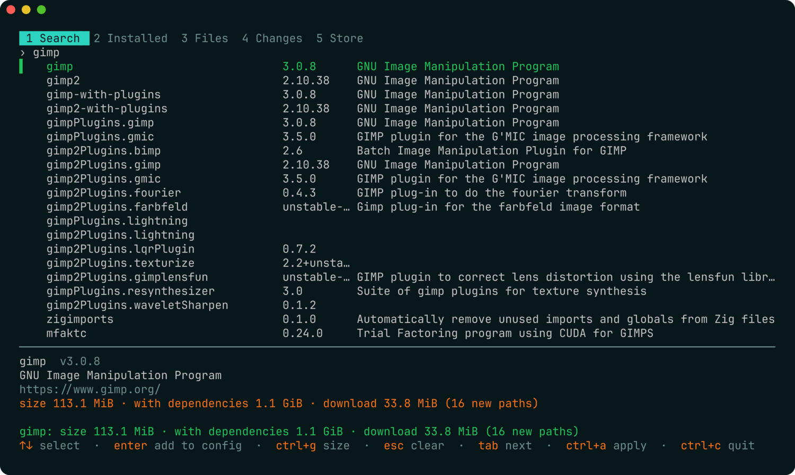
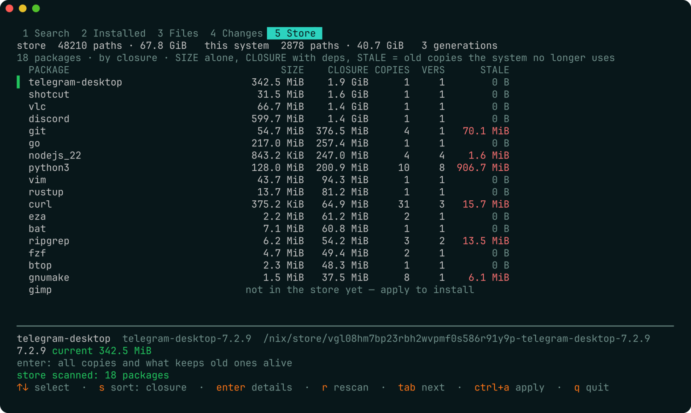
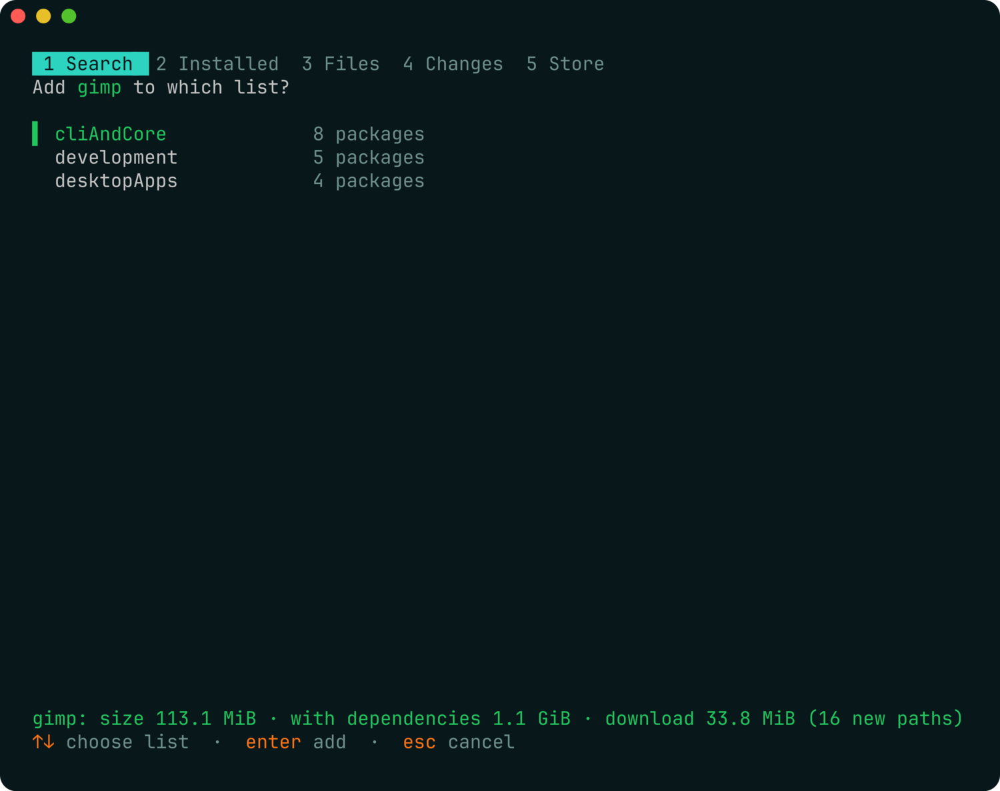
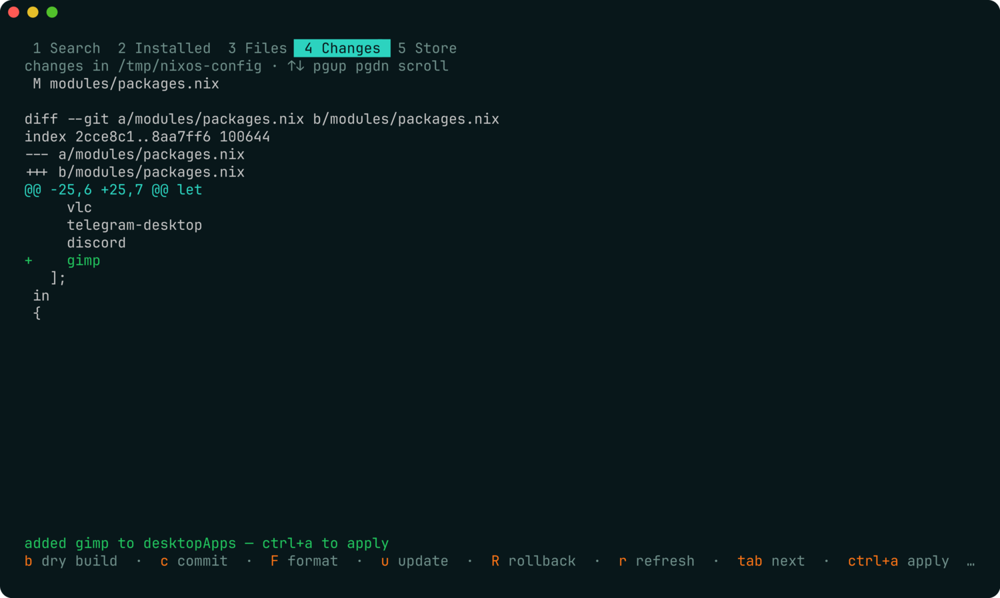
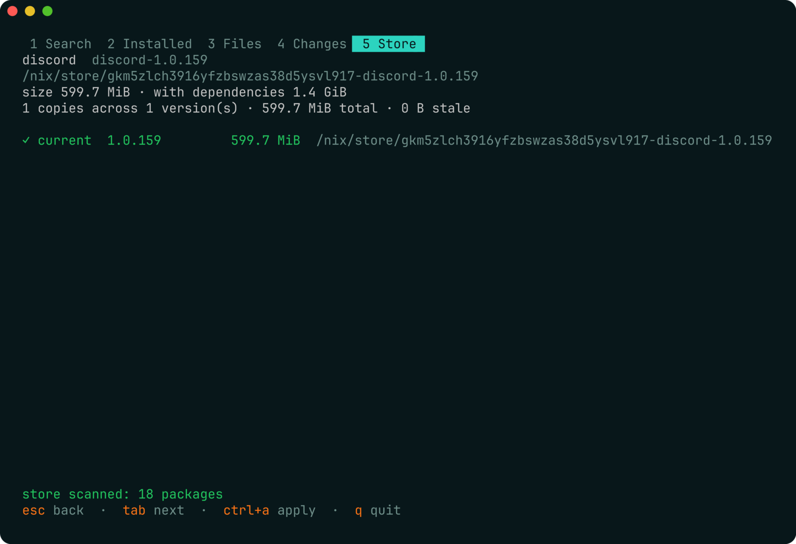
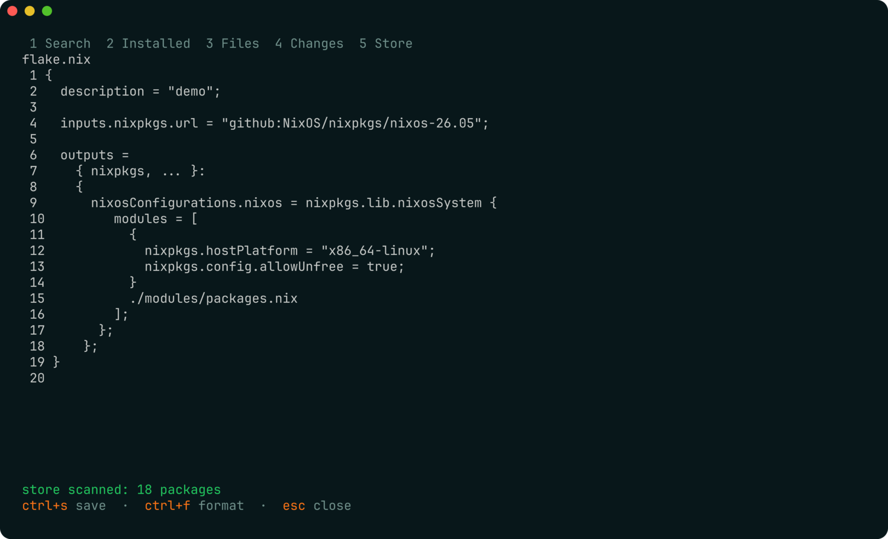

<!-- markdownlint-disable MD033 MD060 -->

<div dir="rtl" lang="ar">

<p align="center">
  
</p>

<h1 align="center">nixtui</h1>

<p align="center">
  <strong>ابحث في nixpkgs. أضف الحزمة بضغطة واحدة. وانظر كم تكلّف.</strong><br/>
  واجهة طرفية تعدّل flake نظام NixOS نيابةً عنك — ثم تعيد بناءه.<br/>
  <span dir="ltr">Go · Bubble Tea · Nix flakes · nixfmt مضمّن</span>
</p>

<p align="center">
  <a href="https://github.com/Shenepoy/nixtui/releases/latest"></a>
  <a href="https://github.com/Shenepoy/nixtui/actions/workflows/ci.yml"></a>
  
  
  
  <a href="LICENSE"></a>
</p>

<p align="center">
  <a href="#التثبيت">التثبيت</a>
  ·
  <a href="#التحديثات">التحديثات</a>
  ·
  <a href="#لقطات">لقطات</a>
  ·
  <a href="#ماذا-تقدّم">ماذا تقدّم؟</a>
  ·
  <a href="#الاستخدام">الاستخدام</a>
  ·
  <a href="#تبويب-المخزن">تبويب المخزن</a>
  ·
  <a href="#كيف-يعدّل-إعداداتك">كيف يعدّل</a>
  ·
  <a href="#التطوير">التطوير</a>
  <br/>
  <a href="README.md"><span dir="ltr">English</span></a>
</p>

<p align="center">
  <code>curl -fsSL https://raw.githubusercontent.com/Shenepoy/nixtui/main/install.sh | sh</code>
</p>

</div>

---

<div dir="rtl" lang="ar">

## التثبيت

### بسطر واحد

</div>

```bash
curl -fsSL https://raw.githubusercontent.com/Shenepoy/nixtui/main/install.sh | sh
```

<div dir="rtl" lang="ar">

ينزّل الملف التنفيذي المناسب لجهازك (x86_64 أو aarch64)، و**يتحقق من SHA-256**
مقابل ملف `sha256sums.txt` المرفق بالإصدار، ثم يضعه في `~/.local/bin`. لا يلمس
شيئًا آخر.

| المتغير | المعنى |
|---|---|
| `NIXTUI_VERSION` | تثبيت إصدار محدد، مثل `26.11.0` (الافتراضي: أحدث إصدار) |
| `NIXTUI_INSTALL_DIR` | التثبيت في مكان غير `~/.local/bin` |

</div>

```bash
curl -fsSL https://raw.githubusercontent.com/Shenepoy/nixtui/main/install.sh | NIXTUI_VERSION=26.11.0 sh
```

<div dir="rtl" lang="ar">

### عبر Nix

</div>

```bash
nix run github:Shenepoy/nixtui                 # جرّبه دون تثبيت
nix profile install github:Shenepoy/nixtui     # ثبّته لمستخدمك
```

<div dir="rtl" lang="ar">

حزمة Nix تضمّ `nixfmt`، فيعمل المنسّق مباشرةً.

أو كمُدخَل (input) في flake نظامك:

</div>

```nix
inputs.nixtui.url = "github:Shenepoy/nixtui";
inputs.nixtui.inputs.nixpkgs.follows = "nixpkgs";

# في أي وحدة (module)
environment.systemPackages = [ inputs.nixtui.packages.${pkgs.stdenv.hostPlatform.system}.default ];
```

<div dir="rtl" lang="ar">

### إصدارات GitHub

تنشر البنايات الموسومة ملفات تنفيذية ثابتة للينكس:

- [أحدث إصدار](https://github.com/Shenepoy/nixtui/releases/latest)
- `nixtui-linux-x86_64` و`nixtui-linux-aarch64` — ملف تنفيذي مستقل بلا اعتماديات
- `sha256sums.txt` — المجاميع الاختبارية للملفين

الإصدارات تقويمية مثل لمحة: `YY.0M.MICRO` (أول إصدار في نوفمبر 2026 هو
`26.11.0`). يبدأ الوسم بـ `v` ويتبعه الرقم الموجود في ملف `VERSION`.

تتوقع الملفات التنفيذية المستقلة وجود `nix` و`git` (و`sudo` عند **التطبيق**) في
`PATH`. وللمنسّق تستخدم `nixfmt` الموجود في `PATH`؛ أما حزمة Nix فتأتي بنسختها.

</div>

---

<div dir="rtl" lang="ar">

## التحديثات

ينبّهك nixtui حين يتوفر إصدار أحدث. مرة في اليوم يسأل GitHub عن وسم أحدث إصدار
(طلب عادي دون مصادقة، لا يحمل غير User-Agent عام) ويحفظ الجواب مؤقتًا. وعند وجود
إصدار أحدث تُظهر ترويسة الواجهة:

</div>

```text
↑ update 26.12.0 available · run: nixtui update
```

<div dir="rtl" lang="ar">

ويطبع `nixtui --version` الملاحظة نفسها على stderr، من الذاكرة المؤقتة فقط، فلا
ينتظر الشبكة أبدًا.

</div>

```bash
nixtui update --check     # هل يوجد إصدار أحدث؟
nixtui update             # نزّله، وتحقق من SHA-256، واستبدل هذا الملف
```

<div dir="rtl" lang="ar">

إن جاءتك النسخة عبر Nix (`nix profile` أو flake نظامك) فلا يلمسها
`nixtui update`؛ بل يطلب منك تشغيل `nix profile upgrade nixtui` أو
`nix flake update nixtui`.

| الإعداد | الأثر |
|---|---|
| `--no-update-check` أو `NIXTUI_NO_UPDATE_CHECK=1` | عدم البحث عن إصدارات أبدًا. |
| `NIXTUI_UPDATE_URL` و`NIXTUI_BASE_URL` | توجيه الفحص والتنزيل إلى مرآة. |

لا تفحص نسخ التطوير (حين يقول `nixtui --version` إنها `dev`) أبدًا.

</div>

---

<div dir="rtl" lang="ar">

## لقطات

<div dir="ltr">
<p align="center">
  
</p>

<p align="center">
  
</p>

<p align="center">
  <sub>البحث مع معرفة الحجم · تبويب المخزن مع النسخ القديمة بالأحمر</sub>
</p>
</div>

<details>
<summary>شاشات أخرى</summary>
<div dir="ltr">
<p align="center">
  
</p>
<p align="center">
  
</p>
<p align="center">
  
</p>
<p align="center">
  
</p>
<p align="center">
  <sub>المنتقي · التغييرات · تفصيل المخزن · المحرر</sub>
</p>
</div>
</details>

</div>

---

<div dir="rtl" lang="ar">

## ماذا تقدّم؟

| | |
|---|---|
| **البحث** | نحو 130 ألف حزمة من فهرس قناتك. يُنزَّل مرة واحدة (~9 م.ب)، ويُحفظ منه نسخة خفيفة تتجدد أسبوعيًا، ويبحث أثناء الكتابة. |
| **إضافة بمفتاح واحد** | `enter` على النتيجة، اختر قائمة، وانتهى. تُكتب الحزمة في `modules/packages.nix`؛ ولا يُثبَّت شيء خلف ظهرك. |
| **الحجم أولًا** | `ctrl+g` على النتيجة يسأل cache.nixos.org عن حجمها وحجمها مع التبعيات و**التنزيل الفعلي** — مطروحًا منه ما تملكه أصلًا. |
| **المثبَّتة** | كل مدخل في قوائم حزمك. `x` يزيل مدخلًا، و`e` ينقلك إليه في المحرر. |
| **المخزن** | لكل حزمة: الحجم، والحجم مع التبعيات، وعدد النسخ والإصدارات المحفوظة، والبايتات القديمة، وما يُبقي النسخ القديمة حيّة. |
| **حرّر أي شيء** | محرر مدمج لمستودع الـ flake كله، مع فحص صياغة `nix` عند الحفظ. |
| **التنسيق** | `nixfmt` مضمّن. نسّق الملف المفتوح أو ملفًا أو المستودع كله. |
| **التغييرات** | فرق git، وبناء تجريبي، وإيداع (commit)، و`nix flake update`، وتراجع. |
| **التطبيق** | `ctrl+a` من أي شاشة يزامن إلى `/etc/nixos` ويشغّل `nixos-rebuild switch --flake`. |
| **أسطر الأوامر** | `nixtui add ripgrep -c cliAndCore --apply` — أضف وأعد البناء من سكربت. |
| **التحديث** | ينبّهك حين يصدر إصدار أحدث، و`nixtui update` يحدّث الملف بعد التحقق من المجموع الاختباري. |

</div>

---

<div dir="rtl" lang="ar">

## الاستخدام

</div>

```text
nixtui                                  افتح الواجهة
nixtui search video editor              ابحث عن حزم
nixtui add ripgrep -c cliAndCore        أضف إلى قائمة
nixtui add ripgrep -c cliAndCore --apply   …وأعد البناء
nixtui remove ripgrep                   أزل حزمة
nixtui list                             اعرض القوائم ومدخلاتها
nixtui store                            الأحجام والنسخ والإصدارات القديمة
nixtui info firefox                     الحجم قبل التثبيت
nixtui fmt [--check] [files…]           نسّق ملفات .nix
nixtui apply                            زامن إلى الـ flake الحي وبدّل
nixtui update [--check]                 ابحث عن إصدار أحدث وحدّث
nixtui --version
```

<div dir="rtl" lang="ar">

**الخيارات** (أو متغيرات البيئة): `--repo` / `NIXTUI_REPO` (الافتراضي
`~/nixos-config`)، و`--live` (الافتراضي `/etc/nixos`)، و`--host` /
`NIXTUI_HOST` (الافتراضي `nixos`)، و`--file` (الافتراضي
`<repo>/modules/packages.nix`)، و`--channel` (يُقرأ من `flake.nix` افتراضيًا)،
و`--no-update-check`.

### المفاتيح

| المفتاح | الإجراء |
|---|---|
| `tab` / `shift+tab` | التبويب التالي / السابق |
| `↑ ↓` `pgup` `pgdn` | تحرّك |
| `enter` (البحث) | أضف الحزمة المحددة إلى قائمة |
| `ctrl+g` (البحث) | الحجم والتنزيل من الـ binary cache |
| `x` · `e` (المثبَّتة) | أزل المدخل · افتحه في المحرر عند سطره |
| `enter` · `f` (الملفات) | حرّر · نسّق الملف |
| `ctrl+s` · `ctrl+f` · `esc` (المحرر) | احفظ · نسّق · أغلق |
| `b` `c` `F` `u` `R` `r` (التغييرات) | بناء تجريبي · إيداع · تنسيق الكل · تحديث flake · تراجع · تحديث العرض |
| `s` · `enter` · `r` (المخزن) | ترتيب · كل نسخة وجذورها · إعادة المسح |
| `ctrl+a` | طبّق (أعد البناء) |

</div>

---

<div dir="rtl" lang="ar">

## تبويب المخزن

يعرض لكل حزمة في إعداداتك:

| العمود | المعنى |
|---|---|
| **SIZE** | مسار الحزمة نفسها في المخزن، وحدها. الحزم الغلافية (Android Studio وbottles…) قد تبدو صغيرة جدًا هنا. |
| **CLOSURE** | الحزمة مع كل ما تسحبه من تبعيات. هذه تكلفتها الحقيقية على القرص. |
| **COPIES** | المسارات الفعلية لهذه الحزمة في المخزن، بأي إصدار. |
| **VERS** | عدد الإصدارات المختلفة بين تلك النسخ. |
| **STALE** | بايتات النسخ التي **لم يعد النظام الجاري يستخدمها** — بالأحمر حين يوجد ما يمكن استرداده. |

يضيف الشريط العلوي حجم المخزن كله، وحجم النظام الجاري، وعدد أجيال النظام.
اضغط `enter` على حزمة لترى كل نسخة، وهل هي حالية أم قديمة، وللقديمة **ما
يُبقيها حيّة** (جيل، أو ملف تعريف، أو رابط `result`) أو أنّ لا شيء يُبقيها
وسيحرّرها جامع القمامة.

لا تُعدّ المشتقات المساعدة التي تشترك في الاسم (`bottles-63.2-init` و
`ripgrep-15.2.0-vendor-staging`) إصداراتٍ من الحزمة.

</div>

---

<div dir="rtl" lang="ar">

## كيف يعدّل إعداداتك

يتوقع nixtui أن يحوي `modules/packages.nix` قوائم مسمّاة:

</div>

```nix
let
  cliAndCore = with pkgs; [
    vim
    git
    ripgrep
  ];
in
{
  environment.systemPackages = cliAndCore ++ [ ];
}
```

<div dir="rtl" lang="ar">

يعدّل تلك القوائم **سطرًا بسطر** ويترك كل ما عداها — التعليقات والتنسيق
والخيارات الأخرى — كما هو بايتًا ببايت. يعمل مع الأسطر المضغوطة
(`vim wget curl`) ومع نمط nixfmt حزمة في كل سطر. أما القوائم التي لا تبدأ بـ
`with pkgs;` فيضيف إليها `pkgs.` تلقائيًا.

المدخلات التي بين أقواس مثل `(microsoft-edge.override { … })` تظهر بوصف
`(complex)`. لا يعيد nixtui كتابتها أبدًا؛ افتحها في المحرر.

**الأمان.** لا يُحذف شيء ولا يُعاد بناء شيء دون أن تطلب. إضافة حزمة لا تغيّر
إلا ملفًا نصيًا تراه في تبويب التغييرات. يقوم `apply` بنسخ مستودعك العامل إلى
`/etc/nixos` (مع ترك `secrets/` وشأنه) ثم يشغّل `nixos-rebuild`؛ ويطلب `sudo`
كلمة المرور في طرفيتك أنت. والتراجع هو
`sudo nixos-rebuild switch --rollback`، وهو أيضًا تحت المفتاح `R`.

</div>

---

<div dir="rtl" lang="ar">

## التطوير

**المتطلبات:** Go `1.26.10` أو أحدث. بلا cgo ولا مكتبات نظام.

</div>

```bash
nix develop        # Go + gopls، أو ثبّت Go فقط
make run
make check         # vet + test + gofmt، وهو ما يشغّله CI
make build         # bin/nixtui
make dist          # ملفات الإصدار والمجاميع في dist/
```

<div dir="rtl" lang="ar">

جرّبه بأمان على نسخة مؤقتة من إعداداتك:

</div>

```bash
cp -r ~/nixos-config /tmp/try && go run . --repo /tmp/try
```

<div dir="rtl" lang="ar">

أصدر إصدارًا برفع `VERSION` والإيداع، ثم:

</div>

```bash
git tag "v$(tr -d '[:space:]' < VERSION)"
git push origin main --follow-tags
```

<div dir="rtl" lang="ar">

يختبر Actions ويبني الملفات التنفيذية ويرفقها (مع `sha256sums.txt`) بإصدار
GitHub. يجب أن يطابق الوسمُ ملفَّ `VERSION` وإلا فشل الإصدار.

</div>

---

<div dir="rtl" lang="ar">

## البنية باختصار

- **الفهرس** — يمرّر `packages.json.br` الخاص بالقناة مرة واحدة إلى نسخة محلية خفيفة
- **ملف Nix** — محلّل ومحرّر موجّه بالأسطر لقوائم الحزم (`nixfile.go`)
- **المخزن** — `nix eval` يحلّ الصفات في nixpkgs الخاص بالـ flake عندك، ثم `nix path-info` يقيس أحجامها
- **الواجهة** — Bubble Tea، خمسة تبويبات إضافة إلى المنتقي والمحرر
- **التنسيق** — `nixfmt` عبر الدخل القياسي، تضمّه حزمة Nix
- **التحديث** — فحص يومي مؤقت لوسم أحدث إصدار، و`nixtui update` للتحديث بعد التحقق

</div>

```text
بحث / إضافة / إزالة ─▶ modules/packages.nix ─▶ git diff ─▶ تطبيق
                                                              │
                  ~/nixos-config ──rsync──▶ /etc/nixos ──▶ nixos-rebuild switch --flake
```

---

<div dir="rtl" lang="ar">

## الرخصة

[AGPL-3.0](LICENSE) — استخدم وادرس وعدّل وأعد التوزيع بحرية؛ إن شغّلت نسخة
معدّلة كخدمة على الشبكة، يحق لمستخدميها الحصول على المصدر.

الاسم <span dir="ltr">**nixtui**</span> والشعار ليسا مشمولين بتلك الرخصة. انسخ
الشيفرة إن شئت، لكن أصدر الفرع باسم وأيقونة مختلفين.

</div>

---

<p align="center">
  من <a href="https://shenepoy.com"><strong>shenepoy</strong></a>
  ·
  <a href="https://github.com/Shenepoy">GitHub</a>
</p>
