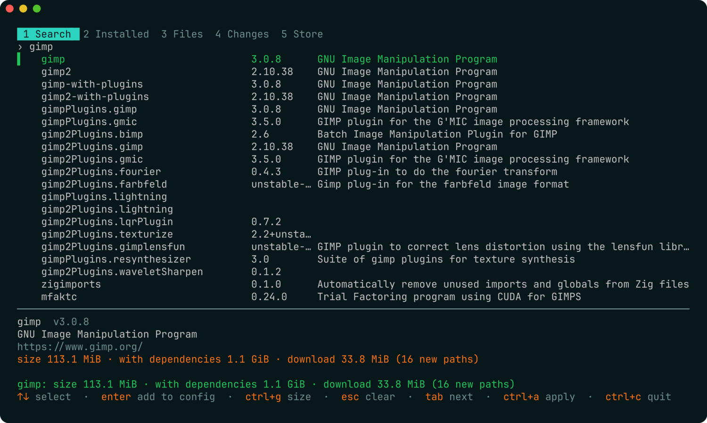
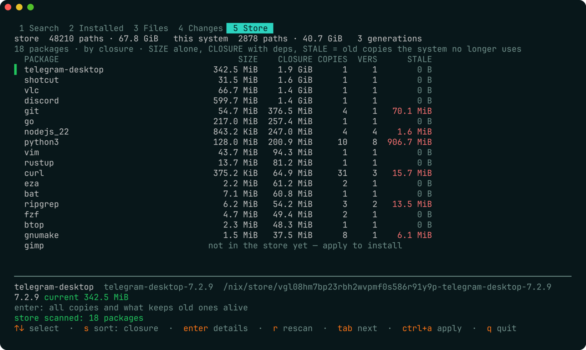
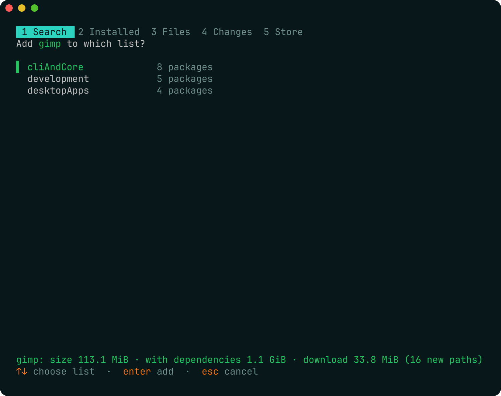
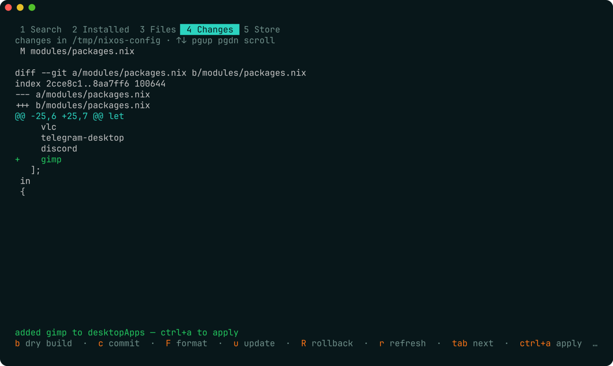
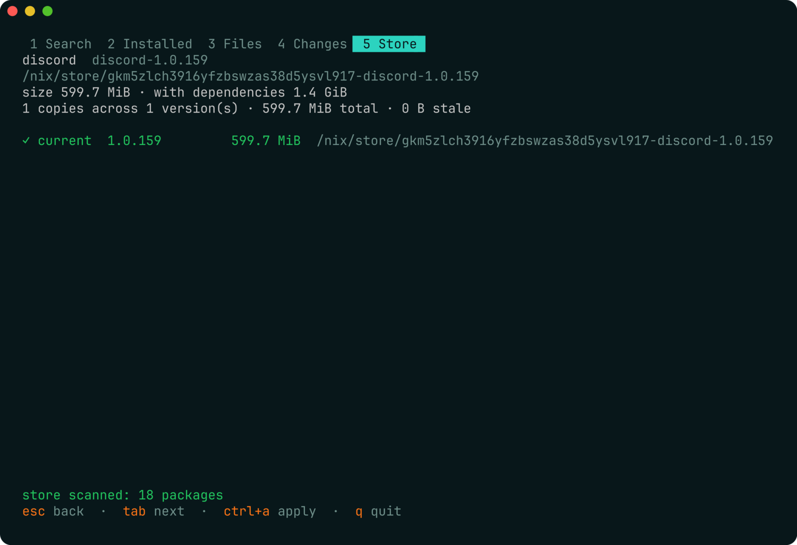
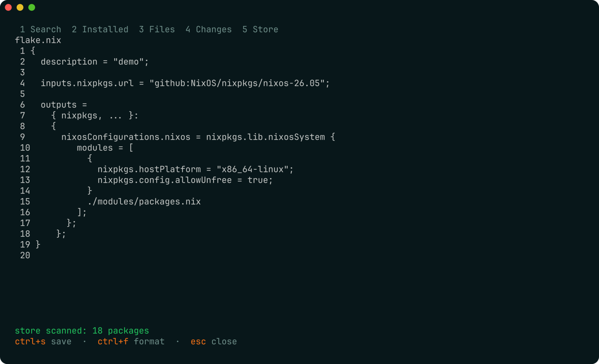

<!-- markdownlint-disable MD033 MD060 -->

<p align="center">
  
</p>

<h1 align="center">nixtui</h1>

<p align="center">
  <strong>Search nixpkgs. Add a package in one keypress. See what it costs.</strong><br/>
  A terminal UI that edits your NixOS flake for you — then rebuilds it.<br/>
  Go · Bubble Tea · Nix flakes · nixfmt bundled.
</p>

<p align="center">
  <a href="https://github.com/Shenepoy/nixtui/releases/latest"></a>
  <a href="https://github.com/Shenepoy/nixtui/actions/workflows/ci.yml"></a>
  
  
  
  <a href="LICENSE"></a>
</p>

<p align="center">
  <a href="#install">Install</a> ·
  <a href="#screenshots">Screenshots</a> ·
  <a href="#what-you-get">What you get</a> ·
  <a href="#usage">Usage</a> ·
  <a href="#the-store-tab">Store tab</a> ·
  <a href="#how-it-edits-your-config">How it edits</a> ·
  <a href="#develop">Develop</a>
</p>

<p align="center">
  <code>curl -fsSL https://raw.githubusercontent.com/Shenepoy/nixtui/main/install.sh | sh</code>
</p>

---

## Install

### One line

```bash
curl -fsSL https://raw.githubusercontent.com/Shenepoy/nixtui/main/install.sh | sh
```

Downloads the right binary for your machine (x86_64 or aarch64), **verifies its
SHA-256** against the release's `sha256sums.txt`, and puts it in
`~/.local/bin`. It touches nothing else.

| Variable | Meaning |
|---|---|
| `NIXTUI_VERSION` | Pin a version, e.g. `26.11.0` (default: latest release) |
| `NIXTUI_INSTALL_DIR` | Install somewhere other than `~/.local/bin` |

```bash
curl -fsSL https://raw.githubusercontent.com/Shenepoy/nixtui/main/install.sh | NIXTUI_VERSION=26.11.0 sh
```

### With Nix

```bash
nix run github:Shenepoy/nixtui                 # try it without installing
nix profile install github:Shenepoy/nixtui     # install for your user
```

The Nix package bundles `nixfmt`, so the formatter works out of the box.

As an input of your own NixOS flake:

```nix
inputs.nixtui.url = "github:Shenepoy/nixtui";
inputs.nixtui.inputs.nixpkgs.follows = "nixpkgs";

# in a module
environment.systemPackages = [ inputs.nixtui.packages.${pkgs.stdenv.hostPlatform.system}.default ];
```

### GitHub Releases

Tagged builds publish static Linux binaries:

- [Latest release](https://github.com/Shenepoy/nixtui/releases/latest)
- `nixtui-linux-x86_64`, `nixtui-linux-aarch64` — single static binaries, no dependencies
- `sha256sums.txt` — checksums for both

Versions are calendar versions like Lamha: `YY.0M.MICRO` (the first November
2026 release is `26.11.0`). The tag is `v` followed by the value in `VERSION`.

The standalone binaries expect `nix`, `git` and (for **apply**) `sudo` on
`PATH`. For the formatter they use a `nixfmt` on `PATH`; the Nix package ships
its own.

---

## Screenshots

<p align="center">
  
</p>

<p align="center">
  
</p>

<p align="center">
  <sub>Search with a size lookup · Store tab with stale copies in red</sub>
</p>

<details>
<summary>More screens</summary>
<p align="center">
  
</p>
<p align="center">
  
</p>
<p align="center">
  
</p>
<p align="center">
  
</p>
<p align="center">
  <sub>Picker · Changes · Store detail · Editor</sub>
</p>
</details>

---

## What you get

| | |
|---|---|
| **Search** | About 130k packages from your channel's index. It downloads once (~9 MB), caches a slim copy, refreshes weekly, and searches as you type. |
| **Add in one key** | `enter` on a result, pick a list, done. The package is written into `modules/packages.nix`; nothing is installed behind your back. |
| **Size first** | `ctrl+g` on a result asks cache.nixos.org for its size, its size with dependencies, and the **real download** — minus what you already have. |
| **Installed** | Every entry in your package lists. `x` removes one, `e` jumps to it in the editor. |
| **Store** | Per package: size, closure, copies and versions kept in the store, stale bytes, and what keeps old copies alive. |
| **Edit anything** | A built-in editor for the whole flake repo, with a `nix` syntax check on save. |
| **Format** | `nixfmt` is bundled. Format the buffer, a file, or the whole repo. |
| **Changes** | The git diff, a dry build, commit, `nix flake update`, rollback. |
| **Apply** | `ctrl+a` from any screen syncs to `/etc/nixos` and runs `nixos-rebuild switch --flake`. |
| **One-liners** | `nixtui add ripgrep -c cliAndCore --apply` — add and rebuild from a script. |

---

## Usage

```text
nixtui                                  open the TUI
nixtui search video editor              search packages
nixtui add ripgrep -c cliAndCore        add to a list
nixtui add ripgrep -c cliAndCore --apply   …and rebuild
nixtui remove ripgrep                   remove a package
nixtui list                             show the lists and their entries
nixtui store                            sizes, copies and stale versions
nixtui info firefox                     size before installing
nixtui fmt [--check] [files…]           format .nix files
nixtui apply                            sync to the live flake and switch
nixtui --version
```

**Flags** (or environment): `--repo` / `NIXTUI_REPO` (default `~/nixos-config`),
`--live` (default `/etc/nixos`), `--host` / `NIXTUI_HOST` (default `nixos`),
`--file` (default `<repo>/modules/packages.nix`), `--channel` (read from your
`flake.nix` by default).

### Keys

| Key | Action |
|---|---|
| `tab` / `shift+tab` | next / previous tab |
| `↑ ↓` `pgup` `pgdn` | move |
| `enter` (Search) | add the selected package to a list |
| `ctrl+g` (Search) | size and download from the binary cache |
| `x` · `e` (Installed) | remove entry · open in the editor at that line |
| `enter` · `f` (Files) | edit · format the file |
| `ctrl+s` · `ctrl+f` · `esc` (editor) | save · format · close |
| `b` `c` `F` `u` `R` `r` (Changes) | dry build · commit · format all · flake update · rollback · refresh |
| `s` · `enter` · `r` (Store) | sort · every copy and its GC roots · rescan |
| `ctrl+a` | apply (rebuild) |

---

## The Store tab

For every package in your config it shows:

| Column | Meaning |
|---|---|
| **SIZE** | The package's own store path, on its own. Wrapper packages (Android Studio, bottles…) can be tiny here. |
| **CLOSURE** | The package plus every dependency it pulls in. This is its real disk cost. |
| **COPIES** | Realised store paths of this package, any version. |
| **VERS** | Distinct versions among those copies. |
| **STALE** | Bytes in copies the **running system no longer uses** — red when there is something to reclaim. |

The header adds the whole store, the running system's closure, and how many
system generations exist. Press `enter` on a package to see each copy, whether
it is current or old, and for old ones **what keeps them alive** (a generation, a
profile, a `result` link) or that nothing does and a garbage collection will
free it.

Auxiliary derivations that share a name (`bottles-63.2-init`,
`ripgrep-15.2.0-vendor-staging`) are not counted as versions of the package.

---

## How it edits your config

nixtui expects `modules/packages.nix` to contain named lists:

```nix
let
  cliAndCore = with pkgs; [
    vim
    git
    ripgrep
  ];
in
{
  environment.systemPackages = cliAndCore ++ [ ];
}
```

It edits those lists **line by line** and leaves everything else — comments,
formatting, other options — byte for byte. It works with compact lines
(`vim wget curl`) and with one-package-per-line nixfmt style. Lists that don't
start with `with pkgs;` are handled by adding `pkgs.`.

Parenthesised entries such as `(microsoft-edge.override { … })` show as
`(complex)`. nixtui never rewrites them; open them in the editor.

**Safety.** Nothing is deleted or rebuilt without you asking. Adding a package
only changes a text file you can see in the Changes tab. `apply` copies your
working repo to `/etc/nixos` (leaving `secrets/` alone) and runs
`nixos-rebuild`; `sudo` prompts in your own terminal. Rollback is
`sudo nixos-rebuild switch --rollback`, also under `R`.

---

## Develop

**Requirements:** Go `1.26.10` or newer. No cgo, no system libraries.

```bash
nix develop        # Go + gopls, or just have Go installed
make run
make check         # vet + test + gofmt, what CI runs
make build         # bin/nixtui
make dist          # release binaries and checksums in dist/
```

Try it safely against a throwaway copy of your config:

```bash
cp -r ~/nixos-config /tmp/try && go run . --repo /tmp/try
```

Cut a release by bumping `VERSION`, committing, then:

```bash
git tag "v$(tr -d '[:space:]' < VERSION)"
git push origin main --follow-tags
```

Actions tests, builds the binaries, and attaches them (with `sha256sums.txt`) to
the GitHub Release. The tag must match `VERSION`, or the release fails.

---

## Architecture (short)

- **Index** — streams the channel's `packages.json.br` once into a slim local cache
- **Nix file** — a line-oriented parser/editor for the package lists (`nixfile.go`)
- **Store** — `nix eval` resolves attributes in your flake's own nixpkgs, then `nix path-info` sizes them
- **UI** — Bubble Tea, five tabs plus the picker and the editor
- **Format** — `nixfmt` over stdin, bundled by the Nix package

```text
search / add / remove ─▶ modules/packages.nix ─▶ git diff ─▶ apply
                                                              │
                  ~/nixos-config ──rsync──▶ /etc/nixos ──▶ nixos-rebuild switch --flake
```

---

## License

[AGPL-3.0](LICENSE) — use, study, modify and redistribute freely; if you run a
modified version as a network service, its users are entitled to your source.

The name **nixtui** and the logo are not covered by that licence. Fork the code,
but please ship a fork under a different name and icon.

---

<p align="center">
  Made by <a href="https://shenepoy.com"><strong>shenepoy</strong></a>
  ·
  <a href="https://github.com/Shenepoy">GitHub</a>
</p>
